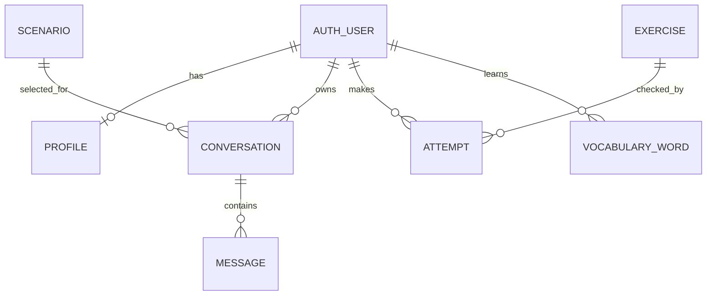

# Схема базы данных

SQLite хранится в `db.sqlite3`, файл создаётся командой `migrate`. Ниже показаны
реальные Django-модели и внешние ключи начальной миграции.

| Модель | Основные поля | Связь |
|---|---|---|
| Profile | level, goal, language | Один профиль на User |
| Scenario | slug, title, description | Уникальный slug |
| Conversation | user, scenario, created_at | Пользователь и сценарий |
| Message | conversation, role, content, feedback, created_at | Сообщение диалога |
| Exercise | title, level, kind, question, answer | Задание и эталон |
| Attempt | user, exercise, answer, is_correct, created_at | Попытка ученика |
| VocabularyWord | user, word, translation, next_review | Слово ученика |

Используется стандартная модель User из Django. Пароли будут обрабатываться
встроенными средствами Django на неделе 2. Email-вход пока не реализован.
Одинаковое слово нельзя добавить одному пользователю дважды — ограничение БД.
При удалении пользователя удаляются связанные записи; сценарий с диалогами
защищён от удаления через PROTECT.

На первой неделе был заполнен справочник Scenario. На второй неделе реально
используются User, Profile, Conversation и Message. Миграциями rest_framework.authtoken
создана таблица authtoken_token для входа в API. Exercise, Attempt и VocabularyWord
остаются основой следующих недель.

Email приводится к нижнему регистру и записывается в уникальный username стандартного
User (максимум 150 символов), а также в поле email. Пользователей приложения следует
создавать через API регистрации; произвольный username администратора не является
email-входом в API.
