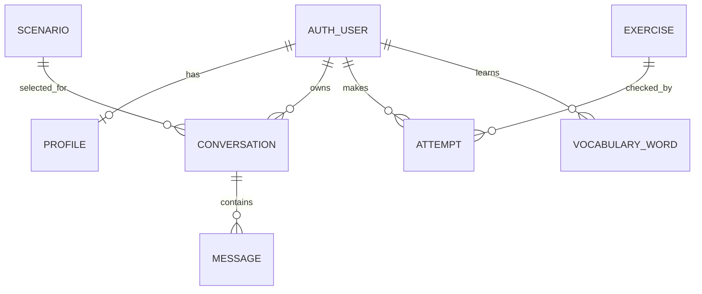

# Схема базы данных

SQLite хранится в `db.sqlite3`, файл создаётся командой `migrate`. Ниже показаны
реальные Django-модели и внешние ключи начальной миграции.

| Модель | Основные поля | Связь |
|---|---|---|
| Profile | level, goal, language | Один профиль на User |
| Scenario | slug, title, description | Уникальный slug |
| Conversation | user, scenario, created_at | Пользователь и сценарий |
| Message | conversation, role, content, feedback, created_at | Сообщение диалога |
| Exercise | title, level, kind, question, answer | Задание и эталон |
| Attempt | user, exercise, answer, is_correct, created_at | Попытка ученика |
| VocabularyWord | user, word, translation, next_review | Слово ученика |

Используется стандартная модель User из Django. Пароли обрабатываются встроенными средствами Django. Реализован вход по email.
Одинаковое слово нельзя добавить одному пользователю дважды — ограничение БД.
При удалении пользователя удаляются связанные записи; сценарий с диалогами
защищён от удаления через PROTECT.

На первой неделе был заполнен справочник Scenario. На второй неделе реально
используются User, Profile, Conversation и Message. Миграциями rest_framework.authtoken
создана таблица authtoken_token для входа в API. На четвёртой неделе используются также Exercise, Attempt и VocabularyWord.

Email приводится к нижнему регистру и записывается в уникальный username стандартного
User (максимум 150 символов), а также в поле email. Пользователей приложения следует
создавать через API регистрации; произвольный username администратора не является
email-входом в API.

## Дополнения четвёртой недели

Exercise получил code, options, explanation, topic и is_placement.
Attempt получил необязательный на уровне БД request_id для совместимости
со старыми данными; в новом POST он обязателен. Уникальность — user + request_id.
VocabularyWord получил streak. Дата следующего повторения хранится в next_review.
PlacementResult хранит ответы, балл и ориентировочный уровень входного теста.
WordReview хранит ответ, результат проверки, перевод на момент ответа и новый срок.
У результатов теста и повторений UUID уникален в пределах пользователя.
Миграция 0002 добавляет поля и таблицы, существующие сообщения и профили сохраняются.

## Пятая неделя

LanguageProgress сохраняет уровень по user/language.
Conversation и Exercise получили language, Message — request_id и reply_to.
PlacementResult и VocabularyWord получили language, слово — дату добавления.
Ограничение уникальности слова действует по user/language/word.
AchievementAward хранит code и дату открытия по user/language.
Note содержит личные заметки выбранного языка.
Источниками графика и ежедневных целей служат даты серверных записей.
